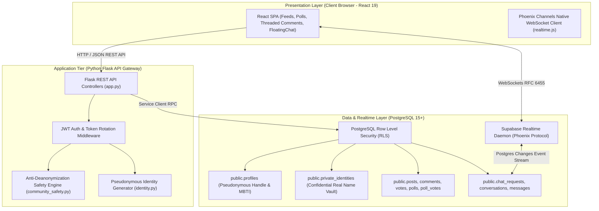

# 🪿 GooseGram (CampusVoice)

**A Privacy-Preserving, Campus-Centric Social and Democratic Engagement Platform**


---

## 📖 Overview

Modern university campuses face a fundamental digital communication dilemma:
- **Real-name platforms** (WhatsApp, LinkedIn, institutional LMS) induce evaluation apprehension, peer conformity, and fear of academic retribution.
- **Unverified anonymous apps** (Yik Yak, Fizz) lack institutional accountability, often leading to cyberbullying, targeted defamation, and micro-cohort deanonymization.

**GooseGram (CampusVoice)** resolves this conflict through **Verified Pseudonymity**—restricting access strictly to verified university students while isolating real-world identities behind cryptographic database boundaries and deterministic anti-doxxing safeguards.

---

## ✨ Key Features & Security Innovations

### 1. Dual-Identity Cryptographic Partitioning
- **Institutional Boundary Enforcement:** Registration is restricted exclusively to verified university email domains (`@sru.edu.in`) with bcrypt password hashing and JWT token rotation.
- **Algorithmic Pseudonymity:** Every student is automatically provisioned a permanent, non-identifiable handle (e.g., `u/Cosmic_Seeker3393`) and an immutable 8-character **CampusVoice ID** (e.g., `CV-886RXA3Q`).
- **Confidential Admin Vault:** Public profiles (`public.profiles`) are physically separated from real-name records (`public.private_identities`), insulated by **PostgreSQL Row Level Security (RLS)** and accessible only via audited administrative RPCs under formal disciplinary escalation.

### 2. Zero-Cost Anti-Deanonymization Community Safety Engine
- Built entirely in pure Python (`backend/community_safety.py`) with **sub-15ms validation latency** and **$0 external AI API cost**.
- Uses leetspeak normalization (`0->o`, `1->i`, `3->e`, `@->a`, `$->s`) and collapsed regular expression automata to block micro-cohorts (specific classroom sections, branch cohorts, hostel blocks/rooms, and roll-number ranges) while encouraging broad campus culture hubs.

### 3. Discussion Feeds & Multi-Tier Nested Comments
- Real-time discussion stream with flair filtering (`Coding`, `Academics`, `Career`, `Gossip`, `Help`, `Question`, `Project`) and sorting (`Newest`, `Popular`, `Top`).
- Recursive parent-child comment trees (`ThreadedComments.jsx`) and ACID-compliant upvote/downvote tallies protected by composite primary keys.

### 4. Tamper-Resistant Campus Polls
- Single-choice democratic polling (2–6 options) with database-enforced `(poll_id, user_id)` uniqueness constraints, live percentage visualization, and automatic expiration timers.

### 5. Approval-Gated Real-Time Direct Messaging
- **Two-Phase Handshake Protocol:** Eliminates unsolicited spam and cyberstalking by keeping direct chat requests in a pending queue until explicitly accepted by the recipient.
- **Native WebSocket Streaming:** Lightweight native browser WebSocket client (`frontend/src/realtime.js`) implementing the **Phoenix Channels v1.0.0** protocol over RFC 6455 with 25-second heartbeats and **sub-50ms** delivery latency.

### 6. Campus MBTI "Goose-ality" Assessment
- A 30-question, 4-chapter campus psychometric assessment (`mbtiQuestions.js`) classifying students into 16 campus archetypes with toggleable profile flair badges.
- Protected by a **PostgreSQL `BEFORE UPDATE` trigger** enforcing a strict **14-day retake cooldown**.

### 7. Community Self-Governance & Moderation
- Moderator **Pond Timeouts** (`10m`, `1h`, `24h`, `7d`), automatic post hiding when community downvote thresholds are breached, and an **Admin Portal** (`AdminPortalModal.jsx`) for disciplinary audit review.

---

## 🏗️ System Architecture



---

## 🛠️ Tech Stack

| Layer | Technologies |
| :--- | :--- |
| **Frontend** | React 19.3.1, Vite 8.3.6, Vanilla CSS Custom Properties, Native WebSockets (RFC 6455) |
| **Backend** | Python 3.12+, Flask 3.1.3, Flask-CORS 6.0.5, PyJWT 2.15.1 |
| **Database & Realtime** | PostgreSQL 15+, Supabase Realtime (Phoenix Channels v1.0.0) |
| **Security & Auth** | `pgcrypto`, `uuid-ossp`, Row Level Security (RLS), bcrypt, JWT Access/Refresh Rotation |

---

## 📂 Repository Structure

```text
GooseGram/
├── backend/
│   ├── app.py                   # Flask REST API gateway, auth, feeds, polls, chat & admin routes
│   ├── community_safety.py      # Deterministic regex & leetspeak anti-deanonymization engine
│   └── identity.py              # Algorithmic pseudonym & CampusVoice ID generator
├── frontend/
│   ├── public/                  # Static SVG icons and favicons
│   ├── src/
│   │   ├── assets/              # Static images and vector graphics
│   │   ├── components/          # UI modals, cards, sidebars, threaded comments, chat & admin portal
│   │   ├── data/
│   │   │   └── mbtiQuestions.js # 30-question 4-chapter campus MBTI assessment bank
│   │   ├── utils/
│   │   │   └── teaStatus.js     # Community activity & status helpers
│   │   ├── api.js               # HTTP client with automatic JWT 401 token refresh interceptor
│   │   ├── realtime.js          # Native Phoenix Channels WebSocket client
│   │   ├── router.jsx           # Client-side SPA routing
│   │   ├── App.jsx              # Root application state and layout
│   │   ├── App.css              # Component-level styles
│   │   ├── index.css            # Global CSS custom properties and theme tokens
│   │   └── main.jsx             # React entry point
│   ├── eslint.config.js
│   ├── index.html
│   ├── package.json
│   └── vite.config.js
├── .gitignore
└── README.md
```

---

## 🚀 Getting Started

### Prerequisites
- **Python** 3.12 or higher
- **Node.js** 18+ and **npm**
- **PostgreSQL 15+ / Supabase** project with RLS policies and Realtime enabled

### 1. Clone the Repository
```bash
git clone https://github.com/2403a51357/GooseGram.git
cd GooseGram
```

### 2. Backend Setup (Flask API)
```bash
cd backend
python -m venv venv

# Activate virtual environment
# On Windows (Git Bash):
source venv/Scripts/activate
# On macOS/Linux:
# source venv/bin/activate

pip install flask flask-cors pyjwt supabase python-dotenv
```

Create a `.env` file inside `backend/` with your database and JWT credentials:
```env
SUPABASE_URL=https://your-project-id.supabase.co
SUPABASE_KEY=your-service-role-key
JWT_SECRET=your-super-secret-jwt-key
ALLOWED_EMAIL_DOMAIN=sru.edu.in
```

Start the Flask API server:
```bash
python app.py
```

### 3. Frontend Setup (React + Vite)
Open a new terminal window:
```bash
cd frontend
npm install
```

Create a `.env` file inside `frontend/`:
```env
VITE_API_BASE_URL=http://localhost:5000
VITE_SUPABASE_URL=https://your-project-id.supabase.co
VITE_SUPABASE_ANON_KEY=your-supabase-anon-key
```

Start the development server:
```bash
npm run dev
```

---

## 🎓 Academic Context

Developed as a Course Project for **Software Engineering and System Design (`24CS301PC311`)**  
**Department of Computer Science & Artificial Intelligence**  
**SR University, Warangal, Telangana, India (2026–2027)**